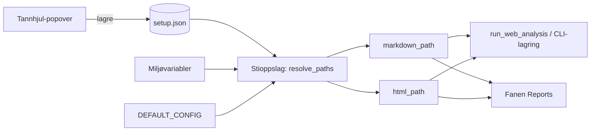

# Arkitektur: Filstier og oppsett i web-grensesnittet

## Formål

Gi brukeren ett sted i web-grensesnittet (`web_app.py`) for å se og endre hvor genererte filer lagres og hvor oppsettsfiler ligger.

## Stier som styres

| Nøkkel | Innhold | Standard |
|---|---|---|
| `markdown_path` | Genererte Markdown-rapporter (`complete_report.md`, proposals) | `DEFAULT_CONFIG["results_dir"]` |
| `html_path` | Genererte HTML-rapporter (samme navn som Markdown, `.html`) | `<markdown_path>/html` |
| `setup_path` | Diverse oppsett (preferanser, lagrede valg) | `~/.tradingagents/setup.json` |

Regler:

- Alle stier lagres som absolutte stier. Relative stier løses mot repo-roten og vises som absolutte i UI.
- Mappene opprettes ved lagring (`Path.mkdir(parents=True, exist_ok=True)`). Skrivbarhet valideres før lagring.
- `html_path` og `markdown_path` kan peke på ulike mapper. Rapportlisten i fanen "Reports" må lese fra begge (Markdown er kilden; HTML er valgfri og sjekkes med `with_suffix(".html")` i dag, så koblingen må gjøres via samme relative struktur eller via en mapping).
- `setup_path` er en JSON-fil. Den skal ikke inneholde API-nøkler. Nøkler forblir i `.env`.

## Oppsettsfil

`setup.json` eksempel:

```json
{
  "markdown_path": "C:/Users/tsa/Documents/Utvikling/TradingAgents/reports",
  "html_path": "C:/Users/tsa/Documents/Utvikling/TradingAgents/reports/html",
  "setup_path": "C:/Users/tsa/.tradingagents/setup.json"
}
```

Prioritet ved oppslag (høyest først):

1. Verdi i `setup.json`
2. Miljøvariabel (`TRADINGAGENTS_MARKDOWN_PATH`, `TRADINGAGENTS_HTML_PATH`)
3. `DEFAULT_CONFIG`-standard

`setup_path` kan ikke overstyres av `setup.json` selv, siden den må finnes for å leses.

## Brukergrensesnitt

- Et tannhjul-ikon (`:material/settings:` i `st.button` / `st.popover`) plasseres øverst til høyre i sidetoppen.
- Klikk åpner en popover med:
  - Tekstfelt for hver sti, med validering (finnes, kan skrives).
  - Knapp "Lagre" som skriver `setup.json`.
  - Knapp "Tilbakestill til standard" som sletter overstyringen for valgt nøkkel.
- Ikonet bruker samme språk som resten av siden (engelsk, med norsk rapportspråk som eget valg).
- Ingen endring i sidepanelet for LLM-innstillinger; de forblir uendret.

## Dataflyt



## Moduler som berøres

| Fil | Endring |
|---|---|
| `tradingagents/default_config.py` | Legge til `markdown_path`, `html_path`, `setup_path` og tilhørende miljønøkler |
| `tradingagents/paths.py` (ny) | `resolve_paths()` og `save_setup()` med validering |
| `web_app.py` | Tannhjul-popover øverst; bruke `resolve_paths()` i stedet for `results_dir` |
| `cli/web.py` | `run_web_analysis` tar imot `markdown_path` og `html_path` |
| `tests/test_paths.py` (ny) | Prioritet, validering, opprettelse av mapper, relative stier |

## Feil og kanttilfeller

- Ugyldig eller ikke-skrivbar sti: vis feil i popover, lagre ikke.
- Korrupt `setup.json`: logg advarsel, bruk standardverdier, ikke krasj.
- Sti flyttet etter lagring: rapportlisten viser tomt med melding, ingen automatisk flytting av filer.

## Åpne beslutninger

- Skal eksisterende rapporter flyttes når stien endres? Anbefaling: nei, kun nye rapporter.
- Skal `setup_path` være global (`~/.tradingagents`) eller per repo? Anbefaling: global, siden den også brukes av CLI.
